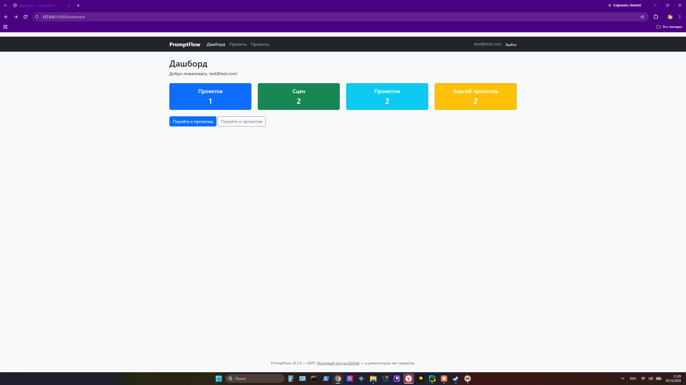
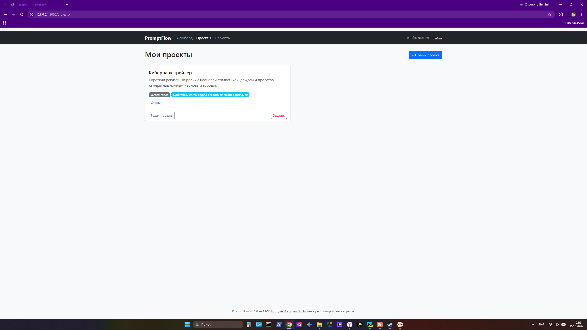
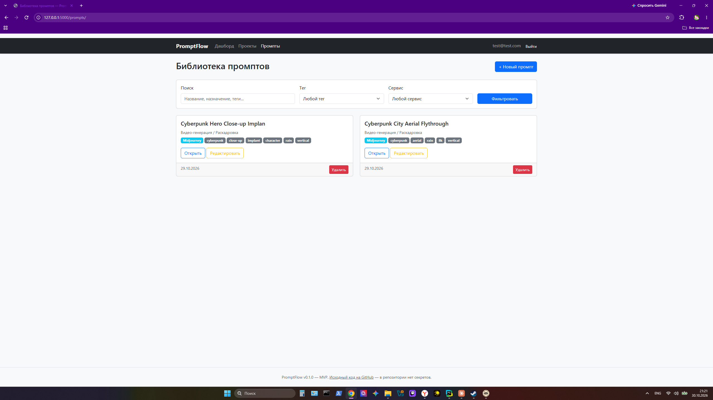
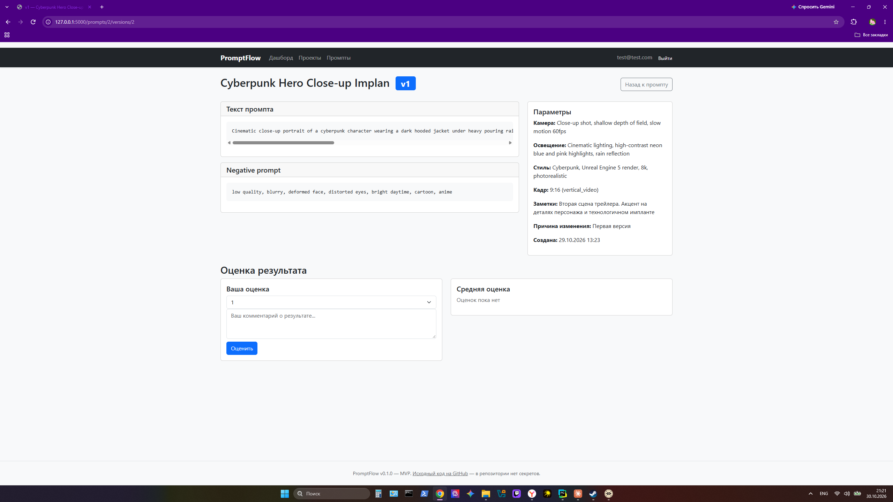

# 🚀 PromptFlow

Веб-приложение на Flask для планирования и организации производства AI-контента: видеороликов, изображений, анимации и других визуальных материалов.

> PromptFlow — это не генератор изображений или видео, а инструмент для организации рабочего процесса. Приложение не привязано к конкретному AI-сервису: названия сервисов — обычные данные, которые пользователь вводит сам.

---

## Проблема и аудитория

Автору AI-контента нужно не только сгенерировать картинку или видео, но и спланировать производство:

1. описать проект и разбить его на сцены;
2. собрать библиотеку промптов;
3. сохранять версии промптов с причинами изменений;
4. оценивать результаты;
5. выгружать готовый производственный план.

PromptFlow закрывает весь этот цикл в одном месте.

## Основные функции

**Аккаунты и безопасность**
- Регистрация, вход, выход; пароли хранятся только в виде безопасного хеша.
- Защита CSRF, страницы ошибок 403/404/500, flash-сообщения.
- Все данные изолированы по пользователю: чужие объекты недоступны для просмотра, редактирования и удаления.

**Проекты и сцены**
- Проект: название, описание, визуальный стиль, формат контента.
- Сцена: порядковый номер, название, описание, длительность, статус (`planned`, `in_progress`, `done`), переупорядочивание.

**Библиотека промптов**
- Промпт: название, назначение, AI-сервис, теги.
- Поиск и фильтрация по названию, назначению, тегам и сервису — только по своим данным.
- Версии: изменение текста создаёт новую версию, старая остаётся доступной; номера последовательны, версии неизменяемы.
- Оценки: шкала 1–5 с комментарием, одна оценка на версию от пользователя.

**Экспорт и аналитика**
- Экспорт проекта в Markdown (читаемый производственный документ) и JSON (структурированные данные) — только для владельца.
- Дашборд: проекты, сцены, промпты, версии, средняя оценка, топ-3 версий.

## 📸 Скриншоты

| Дашборд | Список проектов |
| :---: | :---: |
|  |  |
| *Главная панель со статистикой* | *Управление проектами и тегами* |

| Библиотека промптов | Детали версии промпта |
| :---: | :---: |
|  |  |
| *Фильтрация и поиск по промптам* | *Параметры, версии и оценки* |

## Стек

| Область | Технологии |
| :--- | :--- |
| Язык | Python 3.10+ |
| Фреймворк | Flask, Flask-SQLAlchemy, Flask-Migrate, Flask-Login, Flask-WTF |
| База данных | PostgreSQL (основная), SQLite (тесты, разработка) |
| Интерфейс | Jinja2, Bootstrap 5, Custom CSS |
| Качество | pytest, Ruff |
| Инфраструктура | Docker, Docker Compose, GitHub Actions |

## Архитектура

Приложение построено по схеме Application Factory с blueprints:

| Модуль | Назначение |
| :--- | :--- |
| `app/auth` | регистрация, вход, выход |
| `app/main` | главная страница и дашборд |
| `app/projects` | проекты и сцены (CRUD, переупорядочивание, экспорт) |
| `app/prompts` | библиотека промптов, версии, оценки, поиск |
| `app/services` | сервис экспорта (`export_service.py`) |
| `app/models` | ORM-модели SQLAlchemy |

**Модели**

- `User` — учётная запись, владелец данных.
- `Project` — проект пользователя (связь: сцены).
- `Scene` — сцена проекта (порядок уникален в рамках проекта).
- `Prompt` — запись библиотеки промптов (связь: версии).
- `PromptVersion` — неизменяемый снимок версии промпта.
- `PromptRating` — оценка версии (1–5) с комментарием; одна на версию от пользователя.

Все запросы к пользовательским данным фильтруются по текущему пользователю. Доступ к чужим объектам возвращает 404, чтобы не раскрывать их существование.

## Установка и запуск

```bash
# Создать и активировать виртуальное окружение
python -m venv .venv
source .venv/bin/activate        # macOS/Linux
# .venv\Scripts\activate         # Windows

# Установить зависимости
pip install --upgrade pip
pip install -r requirements.txt

# Скопировать пример конфигурации и заполнить .env
cp .env.example .env

# Применить миграции
flask db upgrade

# Запустить приложение
flask run
```

После запуска приложение доступно по адресу http://127.0.0.1:5000.

## Тесты и линтер

```bash
pytest
ruff check .
```
